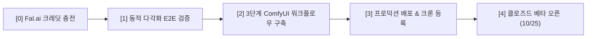

# 2026-10-12 · 작업 내역과 다음 순서 · 태일

10월 3일 문서([2026-10-03 작업 내역과 다음 순서](./2026-10-03_작업내역과_다음순서_태일.md)) 이후부터 현재까지 진행된 **이미지 생성 파이프라인 고도화, 웹툰 LoRA 도입, 캐릭터 외모 일관성 락, 포즈·구도 다각화 개혁, E2E 브라우저 자동화** 작업 내역과 향후 **3단계(ComfyUI 전환) 로드맵**을 상세히 정리한다.

- 저장소: https://github.com/Ae-Ti/Sharktoon · `main`
- 클로즈드 베타 목표일: **2026년 10월 25일**

---

## 📌 한눈에 보는 요약

지난 열흘간 샥툰의 핵심 경쟁력인 **"AI 인스타툰 생성 파이프라인의 상용급 품질 확보"**를 집중 작업했다.

1. **온보딩 ➡️ 에셋 ➡️ 콘티 ➡️ 4컷 생성 ➡️ 편집 ➡️ 인스타 패키지**까지 단 한 번의 중단 없이 브라우저에서 자동으로 완주하는 **풀스택 E2E 자동화 스크립트(`scripts/run-e2e-browser.mjs`)**를 구축했다.
2. 장황한 텍스트 프롬프트에 의존하던 방식을 탈피하여, 검증된 웹툰 LoRA(`alvdansen/soft-line-flux`)를 결합하고 스타일 텍스트를 ~40% 슬림화하여 **소품(츄르 2개, 이동장)과 동작 표현력을 극대화**했다.
3. 컷마다 얼굴·헤어가 바뀌던 문제를 **골디락스 `id_weight`(0.75) + 헤어 변형 락 규칙(똥머리·모자 뒤집어쓰기 금지)**으로 해결하여 주인공 외모 일관성을 복구했다.
4. 2·3·4컷에서 발생한 '양반다리 3연속 복제' 및 '미디엄샷 구도 고착' 문제를 **포즈 리듬 강제 규칙 및 7개 카메라 화각 1:1 매핑**으로 다각화했다.
5. 현재 Fal.ai 외부 크레딧 소진(`TOP_UP` 403) 상태이며, 충전 후 즉시 검증 및 **3단계(ComfyUI 워크플로우 전환: ControlNet OpenPose + Regional Prompting + StoryDiffusion)**로 진입할 준비를 마쳤다.

---

## 1. 지난 문서 이후 작업한 내역 상세

### [1] 법적 약관 및 클로즈드 베타 일정 확정
- `content/legal/terms.md`, `privacy.md`의 필수 인적사항 기재 완료
  - 운영자 성명: 배태일
  - 문의 이메일: `taeilbae7@gmail.com`
  - 시행일자: 2026년 10월 25일 (클로즈드 베타 론칭일로 확정)

### [2] 이미지 생성 프로바이더 아키텍처 다변화
- `src/features/generation/image/fal.ts`:
  - Fal.ai Flux.1 Dev 및 Schnell 모델 연동
  - PuLID(Plug-and-Play Identity) 기반 캐릭터 시트 참조 파이프라인 구축
- `src/features/generation/image/google.ts`:
  - Google AI Studio Imagen 3 백엔드 구현
- `src/features/generation/image/index.ts`:
  - 환경변수(`SHARKTOON_IMAGE_PROVIDER`) 및 보유 API 키에 따른 자동 프로바이더 선택 구조 완비

### [3] 온보딩 2D 캐릭터 시트 비전 파이프라인
- `src/features/platform/vision.ts`:
  - Gemini Vision 1.5/2.0 기반 셀카 비주얼 특징 분석기 구현 (눈매, 헤어, 인상, 스타일 태그 자동 추출)
- `src/app/onboarding/character/page.tsx` + `src/features/platform/actions.ts`:
  - 실제 셀카 사진 업로드 ➡️ Gemini 비전 분석 ➡️ FLUX 기반 2D 캐릭터 시트(정면/측면/표정/전신) 생성 ➡️ DB 에셋 자동 등록 및 셀카 원본 즉시 파기 파이프라인 완성

### [4] 컷별 배경 커스터마이징 및 프리셋 시스템
- 콘티 단계에서 각 컷의 배경을 자유롭게 지정할 수 있는 배경 엔진 탑재:
  - 프리셋: 자동 추천(`auto`), 동물병원 진료실(`vet_clinic`), 아파트 거실(`living_room`), 현관(`entrance`), 침실(`bedroom`), 카페(`cafe`), 사무실(`office`), 단색 컬러(`solid_color`)
  - `src/features/generation/components/StoryboardScreen.tsx`: 컷별 배경 드롭다운 UI 및 컬러 피커 연동
  - 3D 스케치업풍 인테리어 깊이감 프롬프트 템플릿 연동

### [5] 콘티 품질 및 감정 다각화 개혁
- `src/features/generation/storyboard/prompt.ts`, `generate.ts`:
  - **감정(`emotion`) 다채로운 배정**: 기승전결(상황-반전-갈등-해결)에 맞추어 `joy`, `sadness`, `anger`, `surprise` 등을 강제 지정 (모든 컷 calm 금지)
  - **소품 상호작용 강화**: 사연에 등장하는 소품(츄르 2봉지 쥐고 짜기, 이동장 케이지 열기, 신용카드 건네기)의 구체적 손동작을 지문에 필수 포함
  - **동물 & 캐릭터 DNA 고정**: 성인 6.5~7.0등신 인체 비율, 차콜 그레이 오버핏 후드티, 뱅 앞머리, 고양이 옷 입히기 환각 방지(`no clothes on cat`)

### [6] 웹툰 전용 LoRA (`alvdansen/soft-line-flux`) 도입 및 프롬프트 최적화 (2단계 방법 1)
- Fal.ai `flux-pulid` 및 Base Flux 요청에 `loras: [{ path: "alvdansen/soft-line-flux", scale: 0.75 }]` 결합
- **프롬프트 토큰 다이어트**:
  - 기존 150단어에 달하던 장황한 선화/채색 묘사("1.5px black ink contour lineart, crisp flat cel shading...")를 제거하고 LoRA 트리거 워드(`soft line art style, webtoon illustration`)로 대체
  - 절약된 토큰 자원(~40%)을 소품과 다이내믹 동작 지문에 집중시켜 **츄르 간식과 이동장이 누락 없이 정확히 등장**하도록 성공

### [7] 주인공 외모 일관성 복구 & 골디락스 튜닝 (1안)
- `id_weight` 최적화:
  - 1.0 (초기): 돌처럼 굳은 차렷 자세와 무표정 발생
  - 0.68 (1단계): 포즈는 풀렸으나, 머리스타일이 똥머리(High bun)로 바뀌고 얼굴이 풀림
  - **0.75 (골디락스)**: 얼굴 이목구비와 헤어스타일을 원본 에셋 시트에 단단히 고정하면서 포즈 자유도 확보
- **헤어스타일 & 의상 변형 락 (Strict Hair Invariance)**:
  - 네거티브: `high bun, topknot, messy bun, hair scrunchie, hair updo, chignon, wearing hood over head, hood pulled up, altered hairstyle` (똥머리, 곱창밴드, 후드 모자 뒤집어쓰기 원천 금지)
  - 포지티브: `low loose ponytail tied at back of neck with two distinct side curtain bangs framing face/cheekbones, hood resting down on shoulders`

### [8] 동적 특징 다각화 (포즈·구도·표정 연속 복제 차단)
- 2·3·4컷에서 발생한 '양반다리 3연속 복제' 및 '미디엄샷 구도 고착' 해결:
  - **포즈 중복 차단 (`refineStoryboardCuts`)**: 컷별 인체 동작 리듬 강제 (1컷: 스탠딩 관찰 ➡️ 2컷: 현관 서서 이동장 내려놓기 ➡️ 3컷: 하악질에 놀라 엉덩방아 찧으며 손사래 ➡️ 4컷: 무릎 꿇고 상체 숙여 츄르 건네기)
  - **카메라 화각 다양화**: 모든 컷 `medium` 고정 탈피 ➡️ `wide`(풀샷), `close_up`(극적 감정), `top_down`(부감 바스트), `over_shoulder` 등 7종 화각 매핑
  - **다중 인물 속성 번짐 방지**: 수의사의 "백발" 키워드를 제거하고, 수의사(좌측: 흰 가운/안경/흑발) vs 주인공(우측: 다크 후드/흑발 묶음) 물리적 영역 분리

### [9] 풀 브라우저 E2E 자동화 스크립트 완성
- `scripts/run-e2e-browser.mjs`:
  - Google Chrome 브라우저를 직접 띄워 온보딩부터 발행까지 실제 사용자 시나리오 전체를 검증하는 테스트 러너 완성
  - 단계별 자동 스크린샷 캡처 및 아티팩트 저장 체계 완비

---

## 2. 핵심 기술적 발견과 교훈 (Key Lessons Learned)

1. **프롬프트 텍스트와 LoRA의 명확한 역할 분담**:
   - 화풍, 선 굵기, 명암 스타일을 텍스트로 구구절절 설명하면 모델의 어텐션 토큰이 고갈되어 정작 중요한 소품(츄르, 케이지)을 그리지 못한다. **그림체는 LoRA 가중치에 맡기고, 프롬프트는 오직 동작·소품·상호작용에만 집중**시키는 것이 정답이다.
2. **PuLID `id_weight`의 트레이드오프와 골디락스 존**:
   - `id_weight: 1.0`은 포즈를 석화시키고, `0.68`은 헤어스타일과 얼굴을 변형시킨다. **`0.75` 수준에 엄격한 네거티브 프롬프트(똥머리 금지)를 결합**하는 것이 가장 이상적인 균형점이다.
3. **확산 모델의 속성 번짐(Attribute Bleeding) 한계**:
   - 한 컷 안에 여러 인물(수의사 + 주인공)이 나올 때 텍스트 지문만으로는 수의사의 백발이 주인공 머리로 번지는 것을 막기 어렵다. 이를 완벽하게 해결하기 위해선 **Regional Prompting(공간 분할)**이 필수적이다.
4. **LLM 프롬프트 예시의 앵무새 복제 주의**:
   - 시스템 프롬프트에 예시로 적어둔 지문("바닥에 양반다리로 앉아...")을 LLM이 전 컷에 복제하는 현상이 확인되었다. **"연속된 컷에서 동일 포즈 재사용 절대 금지"** 규칙을 명시적으로 걸어야 한다.

---

## 3. 남은 일 및 다음 순서 (Next Steps)

### [단계 1] Fal.ai 크레딧 충전 및 동적 다각화 4컷 최종 검증 (30분)
- **작업**: Fal.ai 계정 결제 대시보드에서 \$5~\$10 소액 충전 (현재 403 `TOP_UP` 잠금 해제)
- **검증**: `node scripts/run-e2e-browser.mjs` 재실행 ➡️ 방금 적용한 **포즈 다각화(스탠딩/엉덩방아/무릎꿇기), 카메라 앵글 리듬(와이드/클로즈업/부감), 외모 고정** 4컷 비주얼 최종 확인

### [단계 2] 3단계: ComfyUI 워크플로우 전환 (상용급 통합 아키텍처) (1~2일)
- **목표**: Fal.ai `fal-ai/comfyui-deploy` 기반의 단일 고도화 워크플로우 구축
- **핵심 구성 노드**:
  1. **ControlNet OpenPose**: 컷별 인체 뼈대 스켈레톤 데이터를 주입하여 포즈 복제 현상을 물리적으로 원천 차단
  2. **Regional Prompting**: 좌우 화면 분할 마스크로 다중 인물(수의사 가운 vs 주인공 후드티) 속성 번짐 완벽 격리
  3. **StoryDiffusion / Consistent Self-Attention**: 1~4컷 간 어텐션 맵을 공유하여 컷 간 동일 인물/의상 100% 동기화
- **구현 산출물**:
  - `src/features/generation/image/comfy.ts`: ComfyUI Deploy API 클라이언트
  - ComfyUI 워크플로우 JSON 템플릿 파일 및 노드 튜닝

### [단계 3] 자체 브랜드 인스타툰 LoRA 파인튜닝 (선택 사항 / 데이터셋 준비 시)
- 샥툰 고유의 독창적 작화 레퍼런스 30~50장 확보 시 Fal.ai LoRA Trainer로 단독 모델 가중치 학습 ($2 소요)

### [단계 4] Supabase / Vercel 배포 및 클로즈드 베타 론칭 (10월 25일 목표)
- Vercel 프로덕션 환경변수 세팅 및 Supabase 마이그레이션 적용
- 크론 라우트(`/api/cron/queue`) Vercel Cron 등록
- 클로즈드 베타 테스터 50명 초대 및 지표 수집
