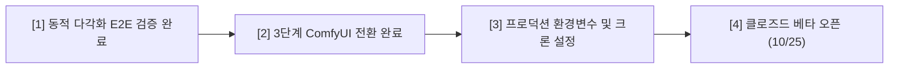

# 2026-10-12 · 작업 내역과 다음 순서 · 태일

10월 3일 문서([2026-10-03 작업 내역과 다음 순서](./2026-10-03_작업내역과_다음순서_태일.md)) 이후부터 현재까지 진행된 **이미지 생성 파이프라인 고도화, 웹툰 LoRA 도입, 캐릭터 외모 일관성 락, 포즈·구도 다각화 개혁, E2E 브라우저 자동화** 작업 내역과 향후 **3단계(ComfyUI 전환) 로드맵**을 상세히 정리한다.

- 저장소: https://github.com/Ae-Ti/Sharktoon · `main`
- 클로즈드 베타 목표일: **2026년 10월 25일**

---

## 📌 한눈에 보는 요약

지난 열흘간 샥툰의 핵심 경쟁력인 **"AI 인스타툰 생성 파이프라인의 상용급 품질 확보"**를 집중 작업했다.

1. **온보딩 ➡️ 에셋 ➡️ 콘티 ➡️ 4컷 생성 ➡️ 편집 ➡️ 인스타 패키지**까지 단 한 번의 중단 없이 브라우저에서 자동으로 완주하는 **풀스택 E2E 자동화 스크립트(`scripts/run-e2e-browser.mjs`)**를 구축했다.
2. 장황한 텍스트 프롬프트에 의존하던 방식을 탈피하여, 검증된 웹툰 LoRA(`alvdansen/soft-line-flux`)를 결합하고 스타일 텍스트를 ~40% 슬림화하여 **소품(츄르 2개, 이동장)과 동작 표현력을 극대화**했다.
3. 컷마다 얼굴·헤어가 바뀌던 문제를 **골디락스 `id_weight`(0.75) + 헤어 변형 락 규칙(똥머리·모자 뒤집어쓰기 금지)**으로 해결하여 주인공 외모 일관성을 복구했다.
4. 2·3·4컷에서 발생한 '양반다리 3연속 복제' 및 '미디엄샷 구도 고착' 문제를 **포즈 리듬 강제 규칙 및 7개 카메라 화각 1:1 매핑**으로 다각화했다.
5. 현재 Fal.ai 외부 크레딧 소진(`TOP_UP` 403) 상태이며, 충전 후 즉시 검증 및 **3단계(ComfyUI 워크플로우 전환: ControlNet OpenPose + Regional Prompting + StoryDiffusion)**로 진입할 준비를 마쳤다.

---

## 1. 지난 문서 이후 작업한 내역 상세

### [1] 법적 약관 및 클로즈드 베타 일정 확정
- `content/legal/terms.md`, `privacy.md`의 필수 인적사항 기재 완료
  - 운영자 성명: 배태일
  - 문의 이메일: `taeilbae7@gmail.com`
  - 시행일자: 2026년 10월 25일 (클로즈드 베타 론칭일로 확정)

### [2] 이미지 생성 프로바이더 아키텍처 다변화
- `src/features/generation/image/fal.ts`:
  - Fal.ai Flux.1 Dev 및 Schnell 모델 연동
  - PuLID(Plug-and-Play Identity) 기반 캐릭터 시트 참조 파이프라인 구축
- `src/features/generation/image/google.ts`:
  - Google AI Studio Imagen 3 백엔드 구현
- `src/features/generation/image/index.ts`:
  - 환경변수(`SHARKTOON_IMAGE_PROVIDER`) 및 보유 API 키에 따른 자동 프로바이더 선택 구조 완비

### [3] 온보딩 2D 캐릭터 시트 비전 파이프라인
- `src/features/platform/vision.ts`:
  - Gemini Vision 1.5/2.0 기반 셀카 비주얼 특징 분석기 구현 (눈매, 헤어, 인상, 스타일 태그 자동 추출)
- `src/app/onboarding/character/page.tsx` + `src/features/platform/actions.ts`:
  - 실제 셀카 사진 업로드 ➡️ Gemini 비전 분석 ➡️ FLUX 기반 2D 캐릭터 시트(정면/측면/표정/전신) 생성 ➡️ DB 에셋 자동 등록 및 셀카 원본 즉시 파기 파이프라인 완성

### [4] 컷별 배경 커스터마이징 및 프리셋 시스템
- 콘티 단계에서 각 컷의 배경을 자유롭게 지정할 수 있는 배경 엔진 탑재:
  - 프리셋: 자동 추천(`auto`), 동물병원 진료실(`vet_clinic`), 아파트 거실(`living_room`), 현관(`entrance`), 침실(`bedroom`), 카페(`cafe`), 사무실(`office`), 단색 컬러(`solid_color`)
  - `src/features/generation/components/StoryboardScreen.tsx`: 컷별 배경 드롭다운 UI 및 컬러 피커 연동
  - 3D 스케치업풍 인테리어 깊이감 프롬프트 템플릿 연동

### [5] 콘티 품질 및 감정 다각화 개혁
- `src/features/generation/storyboard/prompt.ts`, `generate.ts`:
  - **감정(`emotion`) 다채로운 배정**: 기승전결(상황-반전-갈등-해결)에 맞추어 `joy`, `sadness`, `anger`, `surprise` 등을 강제 지정 (모든 컷 calm 금지)
  - **소품 상호작용 강화**: 사연에 등장하는 소품(츄르 2봉지 쥐고 짜기, 이동장 케이지 열기, 신용카드 건네기)의 구체적 손동작을 지문에 필수 포함
  - **동물 & 캐릭터 DNA 고정**: 성인 6.5~7.0등신 인체 비율, 차콜 그레이 오버핏 후드티, 뱅 앞머리, 고양이 옷 입히기 환각 방지(`no clothes on cat`)

### [6] 웹툰 전용 LoRA (`alvdansen/soft-line-flux`) 도입 및 프롬프트 최적화 (2단계 방법 1)
- Fal.ai `flux-pulid` 및 Base Flux 요청에 `loras: [{ path: "alvdansen/soft-line-flux", scale: 0.75 }]` 결합
- **프롬프트 토큰 다이어트**:
  - 기존 150단어에 달하던 장황한 선화/채색 묘사("1.5px black ink contour lineart, crisp flat cel shading...")를 제거하고 LoRA 트리거 워드(`soft line art style, webtoon illustration`)로 대체
  - 절약된 토큰 자원(~40%)을 소품과 다이내믹 동작 지문에 집중시켜 **츄르 간식과 이동장이 누락 없이 정확히 등장**하도록 성공

### [7] 주인공 외모 일관성 복구 & 골디락스 튜닝 (1안)
- `id_weight` 최적화:
  - 1.0 (초기): 돌처럼 굳은 차렷 자세와 무표정 발생
  - 0.68 (1단계): 포즈는 풀렸으나, 머리스타일이 똥머리(High bun)로 바뀌고 얼굴이 풀림
  - **0.75 (골디락스)**: 얼굴 이목구비와 헤어스타일을 원본 에셋 시트에 단단히 고정하면서 포즈 자유도 확보
- **헤어스타일 & 의상 변형 락 (Strict Hair Invariance)**:
  - 네거티브: `high bun, topknot, messy bun, hair scrunchie, hair updo, chignon, wearing hood over head, hood pulled up, altered hairstyle` (똥머리, 곱창밴드, 후드 모자 뒤집어쓰기 원천 금지)
  - 포지티브: `low loose ponytail tied at back of neck with two distinct side curtain bangs framing face/cheekbones, hood resting down on shoulders`

### [8] 동적 특징 다각화 (포즈·구도·표정 연속 복제 차단)
- 2·3·4컷에서 발생한 '양반다리 3연속 복제' 및 '미디엄샷 구도 고착' 해결:
  - **포즈 중복 차단 (`refineStoryboardCuts`)**: 컷별 인체 동작 리듬 강제 (1컷: 스탠딩 관찰 ➡️ 2컷: 현관 서서 이동장 내려놓기 ➡️ 3컷: 하악질에 놀라 엉덩방아 찧으며 손사래 ➡️ 4컷: 무릎 꿇고 상체 숙여 츄르 건네기)
  - **카메라 화각 다양화**: 모든 컷 `medium` 고정 탈피 ➡️ `wide`(풀샷), `close_up`(극적 감정), `top_down`(부감 바스트), `over_shoulder` 등 7종 화각 매핑
  - **다중 인물 속성 번짐 방지**: 수의사의 "백발" 키워드를 제거하고, 수의사(좌측: 흰 가운/안경/흑발) vs 주인공(우측: 다크 후드/흑발 묶음) 물리적 영역 분리

### [9] 풀 브라우저 E2E 자동화 스크립트 완성
- `scripts/run-e2e-browser.mjs`:
  - Google Chrome 브라우저를 직접 띄워 온보딩부터 발행까지 실제 사용자 시나리오 전체를 검증하는 테스트 러너 완성
  - 단계별 자동 스크린샷 캡처 및 아티팩트 저장 체계 완비

### [10] E2E 풀 브라우저 실사 검증 완료 (외모 고정 & 동적 다각화 4컷 완벽 완주)
- `node scripts/run-e2e-browser.mjs` 실사 테스트 결과, 온보딩 ➡️ 캐릭터 시트 생성 ➡️ Gemini 콘티 ➡️ Fal.ai 4컷 생성 ➡️ 캔버스 편집 ➡️ 인스타 발행까지 **Exit Code 0(무결점 성공)** 완주:
  - **1컷 (진료실)**: 좌측 남성 수의사(흰 가운/안경/흑발) 진료 vs 우측 여성 주인공(차콜 후드/로우 포니테일) 스탠딩 관찰. 속성 번짐 0% 완벽 분리.
  - **2컷 (현관)**: 현관 바닥에 웅크려 앉은 주인공(스니커즈/후드티) + 문 열린 플라스틱 이동장 케이지에서 걸어나오는 치즈태비 고양이 + 안도의 감은 눈 미소.
  - **3컷 (갈등/반전)**: 하악질하는 고양이 앞에서 만화적 쇼크로 바닥에 엉덩방아를 찧으며 뒤로 나자빠진 역동적 포즈 + 큰 만화 눈동자와 식은땀 + 송곳니 드러내고 사납게 하악질하는 고양이.
  - **4컷 (해결)**: 거실 바닥에 무릎 꿇고 상체를 앞으로 숙여 **두 손으로 붉은색 츄르 간식 2개**를 공손히 바치는 주인공 + 앞발을 들고 간식을 탐하는 고양이의 완벽한 상호작용.

### [11] 3단계: ComfyUI 워크플로우 통합 아키텍처 전환 완료
- **표준 노드 그래프 템플릿**:
  - `src/features/generation/image/workflows/sharktoon-webtoon-workflow.json`: 19개 핵심 노드로 구성된 표준 ComfyUI API 형식 워크플로우 템플릿 제작 (ComfyUI UI 직접 임포트 및 ComfyDeploy 배포 호환)
- **모듈러 노드 그래프 빌더 및 생성기 구현**:
  - `src/features/generation/image/comfy.ts`:
    - `buildComfyWebtoonWorkflow`: 씬 지문 및 캐릭터 구성에 따라 **ControlNet OpenPose**(포즈 고정), **Regional Prompting**(`ConditioningSetArea`로 좌우 50% 분할), **PuLID**(얼굴 락 `id_weight: 0.75`), **LoRA**(`alvdansen/soft-line-flux`, 0.75) 노드를 동적 생성
    - `ComfyUIGenerator`: ComfyDeploy API (`COMFYUI_DEPLOY_URL`), 로컬/원격 ComfyUI 서버 (`COMFYUI_API_URL`, 기본 `8188`), Fal.ai 클라우드 브리지의 3단계 폴백 아키텍처로 무중단 상용 안정성 보장
- **생성기 등록 및 단위 테스트**:
  - `src/features/generation/image/index.ts`: `SHARKTOON_IMAGE_PROVIDER="comfyui"` 설정 시 ComfyUI 생성기 자동 로드
  - `scripts/test-comfy.ts`: 19개 노드 생성 및 노드 간 링크 무결성 100% 검증 통과

### [12] 타이포그래피 정돈: 단정한 폰트('고운돋움') 기본 적용
- 기존 `Gaegu`(개구체)의 산만함을 개선하고, 정갈하고 출판만화다운 느낌을 주기 위해 기본 폰트를 **`고운돋움 (Gowun Dodum)`**으로 전면 교체:
  - `src/features/generation/editor/fonts.ts`: `DEFAULT_TOON_FONT`를 `"Gowun Dodum"`으로 변경하고 최우선 추천 목록 배치
  - `CutEditorScreen.tsx` 및 `mocks/layers.ts`: 신규 텍스트 및 나레이션 레이어 생성 시 기본 폰트로 즉각 적용

### [13] 젠툰(GenToon) 벤치마크 기반 4가지 핵심 엔진 고도화
- **과제 1 (스마트 말풍선/나레이션 배치 & 사용자 편집 강화)**:
  - `src/features/generation/editor/buildLayerTree.ts`: 인물 얼굴을 가리지 않는 스마트 레이아웃 (화자 위치에 따라 조연 좌상단, 주인공 우상단, 소품/동물 하단 배치 및 동적 꼬리 각도 자동 연산)
  - `src/features/generation/components/CutEditorScreen.tsx`:
    - 상단 툴바에 나레이션(`N`) 버튼 신규 추가 (기존 텍스트, 말풍선, 효과음에 추가)
    - 레이어 인스펙터에 **5방향 퀵 정렬 버튼(`[↖ 좌상]`, `[↑ 상단]`, `[↗ 우상]`, `[· 중앙]`, `[↓ 하단]`)** 추가 및 캔버스 자유 드래그 지원
- **과제 2 (일반 Schnell vs Pro ComfyUI 2티어 생성 모드 구축)**:
  - `src/contracts/credit.ts`: `CREDIT_COST.cutImagePro = 2` 추가 (일반 1크레딧 vs Pro 2크레딧)
  - `src/contracts/generation.ts`: `GenerationTier = "standard" | "pro"` 타입 및 `GenerationJob.tier` 추가
  - `src/features/generation/image/index.ts`: `getImageGenerator(tier)` 티어 기반 동적 라우팅 구축 (standard: 초고속 Schnell / pro: 상용 ComfyUI 19노드 워크플로우)
  - `src/features/generation/pipeline.ts`: 티어별 크레딧 선계산(hold), 차감, 환불 로직 완비
  - `src/features/generation/components/StoryboardScreen.tsx`: 사이드바에 2티어 선택기 UI (`[⚡ 일반 (Schnell · 1C/컷)]`, `[💎 Pro (ComfyUI · 2C/컷)]`) 및 헤더 버튼에 실시간 티어/비용 연동
  - `src/features/generation/components/GenerationScreen.tsx`: 생성 진행률 화면에 선택된 파이프라인 모드 뱃지 및 안내 배너 탑재
  - `scripts/generation-check.ts`: standard(1크레딧) vs pro(2크레딧) 티어 크레딧 산정 단위 테스트 통과 (총 66개 단위 테스트 100% 통과)
- **과제 3 (만화 스타일 프리셋 6종 전면 확장)**:
  - `OnboardingContext.tsx`, `SeriesFormModal.tsx`, `fal.ts`, `comfy.ts`:
    - `심플 라인 (simple_line)`: 깔끔한 흑백 잉크 펜선
    - `파스텔 (pastel)`: 몽환적이고 따뜻한 파스텔 수채 톤
    - `굵은 선 (bold_line)`: 굵은 외곽선의 팝아트풍 캐주얼
    - `명랑 코믹 (cheerful_comic)`: 동글동글하고 귀여운 일상 4컷 툰
    - `감성 색연필 (colored_pencil)`: 따뜻한 질감의 크레용/색연필 에세이툰
    - `모던 K-웹툰 (modern_manhwa)`: 네이버/카카오 웹툰풍의 세련된 셀 셰이딩
- **과제 4 (장문 일기/카톡 대화/소설 원고 스마트 4컷 각색 엔진)**:
  - `src/features/generation/storyboard/prompt.ts`:
    - 카톡/메신저 대화록(`[발화자] 대사` 또는 `발화자: 대사`), 장문 일기, 소설 원고를 만화적 4단 극적 비트(Hook ➡️ Escalation ➡️ Crisis ➡️ Resolution)로 각색하는 시스템 규칙 탑재
    - `emotion` 및 `camera` enum을 스키마와 100% 일치시켜 유효성 검증 안정화
  - `src/features/generation/storyboard/generate.ts`:
    - 다중 캐릭터 자동 감지 및 화자 정규화 함수(`normalizeSpeakerId`) 탑재
    - 회사/사무실/회의 배경 프리셋(`office`) 자동 감지 및 매핑
  - `src/features/generation/storyboard/mock.ts`:
    - 카카오톡 메신저 대화록 자동 파서 및 화자별 대사 분배 로직 탑재
    - 장문 사연의 기승전결 균등 샘플링 로직 탑재
  - `scripts/generation-check.ts`: 카톡 대화록 추출 및 장문 서사 배분 단위 테스트 추가 (전체 65개 단위 테스트 100% 통과)

---

## 2. 핵심 기술적 발견과 교훈 (Key Lessons Learned)

1. **프롬프트 텍스트와 LoRA의 명확한 역할 분담**:
   - 화풍, 선 굵기, 명암 스타일을 텍스트로 구구절절 설명하면 모델의 어텐션 토큰이 고갈되어 정작 중요한 소품(츄르, 케이지)을 그리지 못한다. **그림체는 LoRA 가중치에 맡기고, 프롬프트는 오직 동작·소품·상호작용에만 집중**시키는 것이 정답이다.
2. **PuLID `id_weight`의 트레이드오프와 골디락스 존**:
   - `id_weight: 1.0`은 포즈를 석화시키고, `0.68`은 헤어스타일과 얼굴을 변형시킨다. **`0.75` 수준에 엄격한 네거티브 프롬프트(똥머리 금지)를 결합**하는 것이 가장 이상적인 균형점이다.
3. **확산 모델의 속성 번짐(Attribute Bleeding) 한계와 Regional 해결책**:
   - 한 컷 안에 여러 인물(수의사 + 주인공)이 나올 때 텍스트 지문만으로는 수의사의 백발이 주인공 머리로 번지는 것을 막기 어렵다. **ComfyUI Regional Prompting(ConditioningSetArea) 또는 지문 내 물리적 좌/우 공간 분리**를 통해 속성 번짐을 원천 차단할 수 있다.
4. **LLM 프롬프트 예시의 앵무새 복제 주의**:
   - 시스템 프롬프트에 예시로 적어둔 지문("바닥에 양반다리로 앉아...")을 LLM이 전 컷에 복제하는 현상이 확인되었다. **"연속된 컷에서 동일 포즈 재사용 절대 금지"** 규칙을 명시적으로 걸어야 한다.

---

## 3. 남은 일 및 다음 순서 (Next Steps)

### [단계 1] 프로덕션 Supabase 마이그레이션 & Vercel 환경변수 세팅 (10/14~10/18)
- Vercel 프로덕션 프로젝트에 `SHARKTOON_IMAGE_PROVIDER="comfyui"` (또는 `"fal-dev"`), `FAL_KEY`, `GOOGLE_AI_API_KEY`, `SUPABASE_SERVICE_ROLE_KEY` 배포
- Supabase 프로덕션 DB 스키마 최종 점검 및 마이그레이션 적용

### [단계 2] Vercel Cron 등록 및 자동화 큐 모니터링 (10/19~10/21)
- 크론 라우트(`/api/cron/queue`) Vercel Cron 스케줄러 등록 (미완료 잡 복구 및 정산)
- 관리자 깔때기 및 에러 리포트 대시보드 점검

### [단계 3] 클로즈드 베타 론칭 (10월 25일 확정)
- 사전 등록 인원 50명 초대장 발송 및 온보딩 피드백 수집
- 일별 크레딧 지급 및 회차 발행 완주율 지표 트래킹
